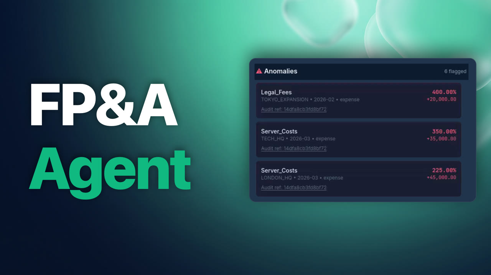
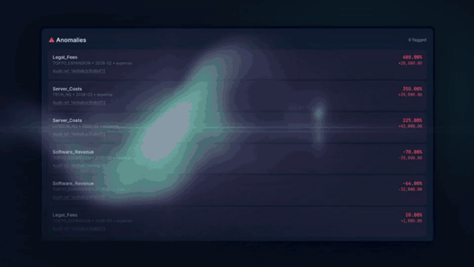
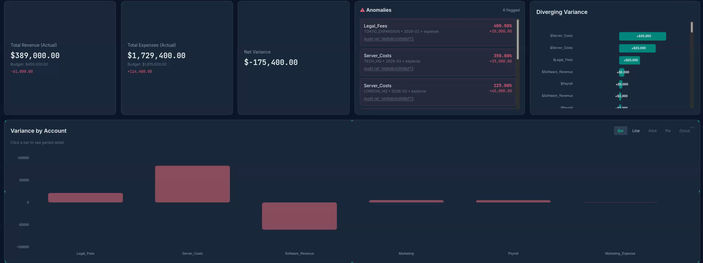
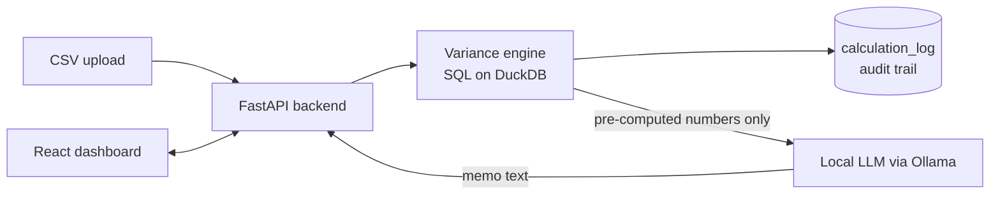
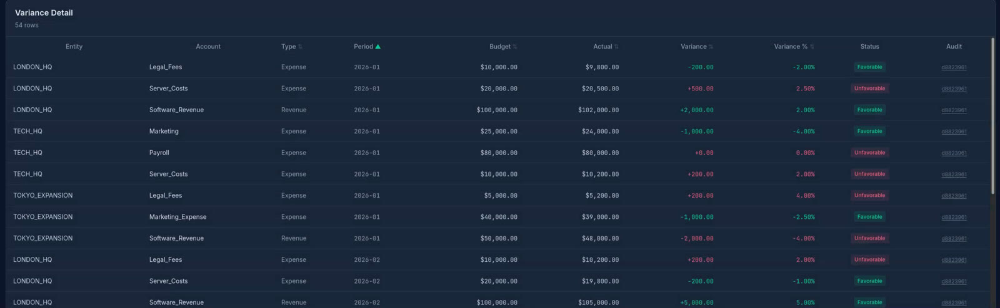

<p align="center">
  
</p>

<h1 align="center">FP&A Agent</h1>

<p align="center">
  <b>Automates the monthly budget-vs-actual review:</b> computes variances, flags anomalies and drafts the variance memo,<br>
  with every figure computed in SQL and traceable to its calculation.
</p>

<p align="center">
  
  
  
  
  
  
  
</p>

<p align="center">
  
  <br><sub><a href="docs/promo_30s.mp4">Watch the 30-second promo (MP4)</a></sub>
</p>

---

## The problem

Every month, finance teams compare budget against actual results line by line in spreadsheets, hunt for the variances that matter, and write a memo explaining them. It is slow, error-prone, and the numbers in the final memo are hard to trace back to their source.

FP&A Agent does the mechanical part: upload the data, and it calculates every variance, surfaces the outliers, and drafts the narrative, while keeping an audit trail of every calculation.

## Features

| | |
|---|---|
| **CSV upload** | Drag-and-drop budget/actual data; account types (revenue / expense) are inferred automatically |
| **KPI cards** | Total revenue, total expenses and net variance against budget |
| **Variance analysis** | By account, period and entity, with favourable / unfavourable status |
| **Anomaly detection** | Flags variances above a configurable threshold (default 10%), each with an audit reference |
| **Drill-down** | Click an account to see its variance across periods |
| **Charts** | Variance by account (bar / line / area / pie / donut), diverging variance, monthly variance + cumulative YTD, actual-vs-budget trendline |
| **Variance memo** | A local LLM drafts the narrative from pre-computed numbers |
| **Audit trail** | Every calculation is recorded in `calculation_log` and linked from the UI |
| **Workspaces** | Independent sessions, each with its own data and history |
| **Dashboard layout** | Drag, resize and add widgets; layout saved per session |



## How the AI is constrained

Language models are good at writing but unreliable at arithmetic, and finance needs numbers that can be audited. So the design separates the two:

- **All financial math runs in SQL and Python** in the variance engine (DuckDB). The LLM never calculates anything.
- **The LLM only writes words**: it receives pre-computed variances and drafts the memo text.
- **Every number is traceable**: each calculation is logged to `calculation_log` with a reference shown in the UI ("Audit ref").
- **Generated SQL is validated** (for the experimental Q&A): SELECT-only and allow-listed tables, with the active session passed to the model.
- **Runs locally**: the model is served by Ollama on your own machine, so financial data never leaves it.





## Quick start

Requires Docker.

```bash
git clone https://github.com/dodo5037/fpa-agent.git
cd fpa-agent
cp .env.example .env
docker compose up --build
```

Then:

1. Open http://localhost:5173 and upload `sample_data.csv`.
2. For the AI memo, pull a model into the Ollama container once:
   ```bash
   docker compose exec ollama ollama pull qwen2.5
   ```
   (The model name is set by `OLLAMA_MODEL` in `.env`.)

The API runs on http://localhost:8000.

## Data format

One row per entity, account, period and scenario:

```csv
entity_id,account_id,account_name,account_type,category,period_id,scenario,amount
NORTH,R001,Product Revenue,revenue,Revenue,2024-01,budget,500000.00
NORTH,R001,Product Revenue,revenue,Revenue,2024-01,actual,520000.00
NORTH,E001,Salaries & Benefits,expense,Personnel,2024-01,budget,280000.00
```

Required columns: `entity_id, account_id, period_id, scenario, amount` (`scenario` is `budget` or `actual`).

## Tests

118 backend tests (API, variance engine, audit logging, schema, seed data, LLM guardrails).

```bash
python3.12 -m venv .venv && source .venv/bin/activate
pip install -r requirements.txt
pytest -q
```

## Project structure

```
backend/   FastAPI app, variance engine, audit logging, LLM integration, sessions
db/        DuckDB schema and seed data
frontend/  React + Vite dashboard
docker/    Dockerfiles and nginx config
tests/     pytest suite
```

## Limitations and roadmap

- **Plain-English Q&A is experimental.** A small local model does not translate questions to SQL reliably yet. Next step: a pre-joined variance view, few-shot examples and human-readable answers.
- Memo headers (date, author) should be filled in by code rather than the model.
- Single-user workspaces; no authentication.
- Memo quality depends on the local model you choose.

## Tech stack

Python 3.12 · FastAPI · DuckDB · pydantic-settings · React (Vite) · nginx · Ollama · Docker Compose · pytest

---

Built by **Abderrahmane Messaoudi**, Industrial Engineering & Engineering Management, University of Sharjah · [LinkedIn](https://www.linkedin.com/in/abderrahmane-messaoudi-984161273/)

Released under the [MIT License](LICENSE).
